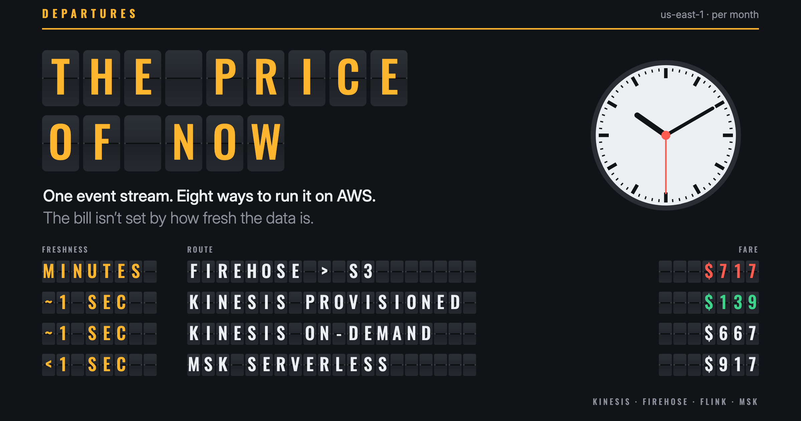
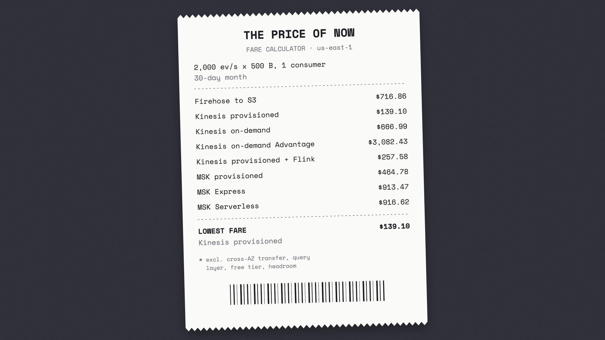
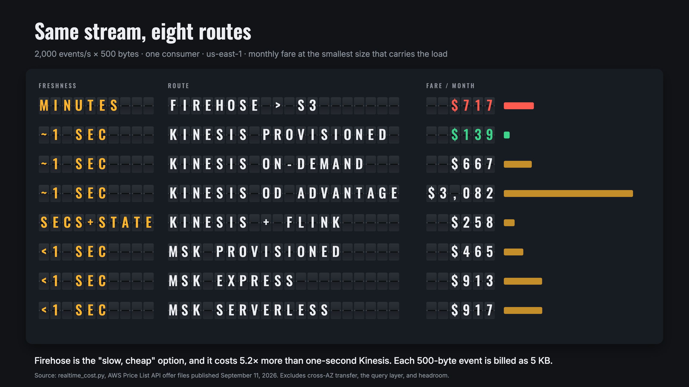
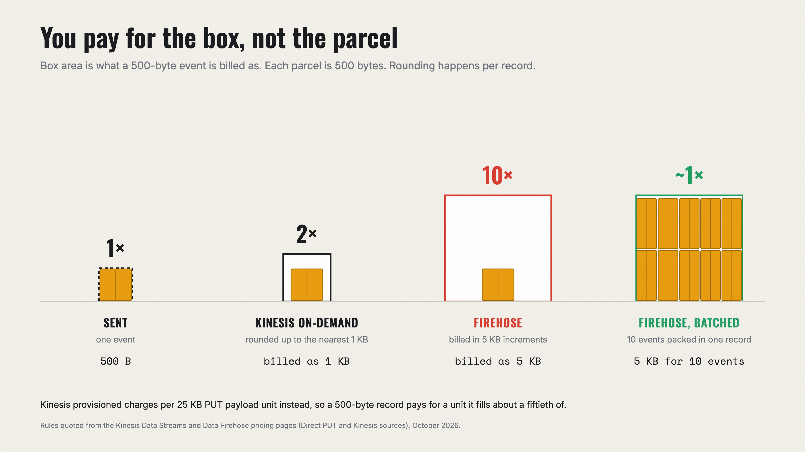
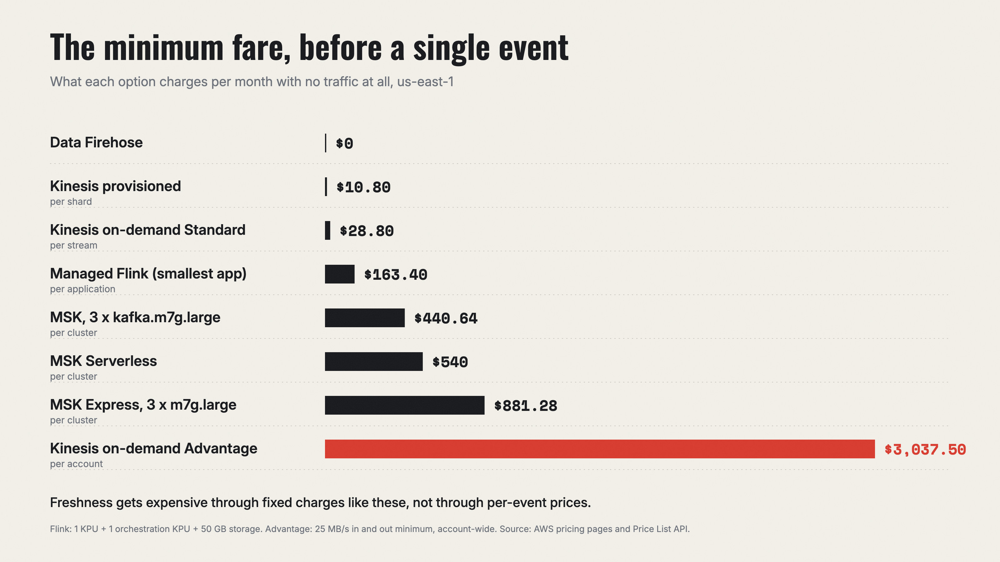
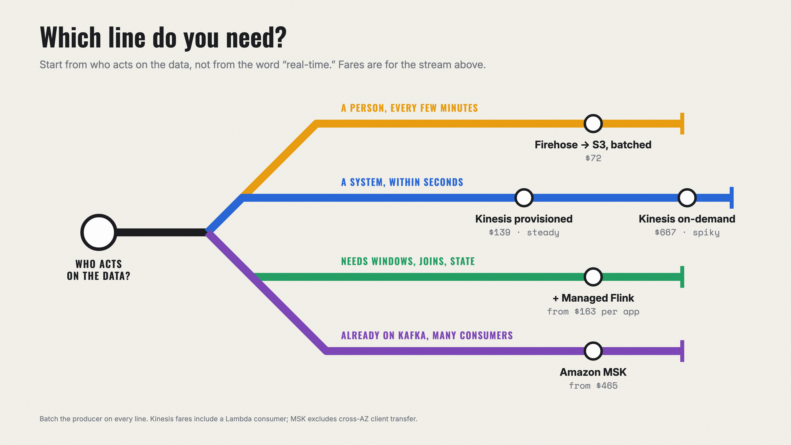
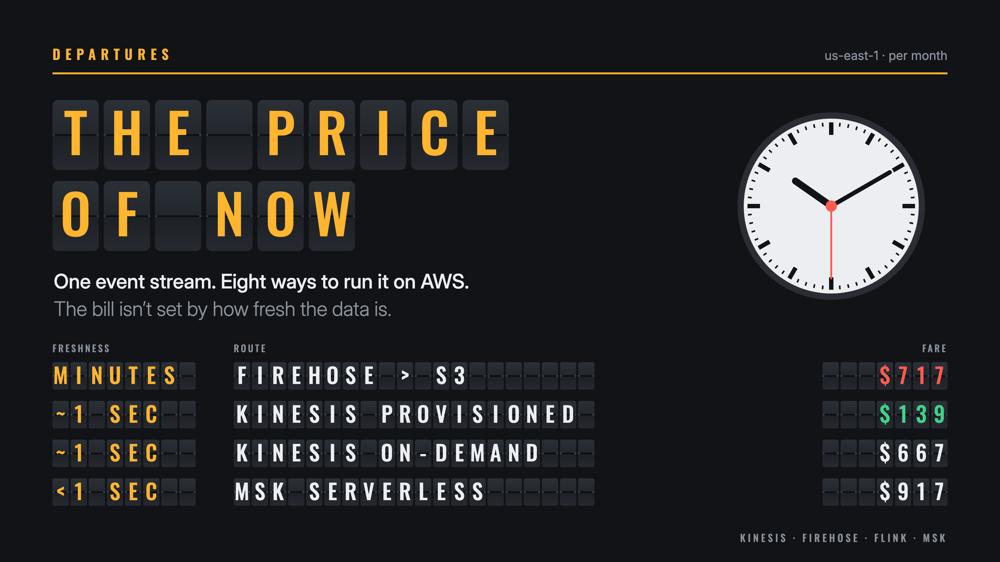

<p align="center">
  
</p>

<h1 align="center">The price of now</h1>

<p align="center">
  What one event stream costs on AWS, priced eight ways, from "a few minutes late" to "under a second."<br>
  Companion code for the article <a href="article/the-price-of-now.md"><b>The Price of Now</b></a>.
</p>

<p align="center">
  <a href="https://github.com/sirik11/price-of-now/actions/workflows/test.yml"></a>
  
  
  <a href="LICENSE"></a>
</p>

---

For 2,000 events per second of 500 bytes, Data Firehose (data a few minutes old) costs **$717 a month**, and a Kinesis data stream with a Lambda consumer (about a second) costs **$139**. Firehose bills ingestion "in 5KB increments," so each 500-byte event is billed as 5 KB. Pack ten events per record and Firehose drops to $72.

The bill is driven by record sizes, capacity modes, and minimum charges, not by freshness. This calculator shows where your money goes.

## Quick start

One file, standard library only, prices included.

```bash
git clone https://github.com/sirik11/price-of-now && cd price-of-now
python3 realtime_cost.py --events 2000 --bytes 500
python3 realtime_cost.py --events 2000 --bytes 500 --batch 10 --detail
```

<p align="center">
  
</p>

| Flag | Meaning | Default |
| --- | --- | --- |
| `--events` | events per second | 2000 |
| `--bytes` | average event size | 500 |
| `--consumers` | applications reading the stream | 1 |
| `--batch` | events your producer packs into one record | 1 |
| `--detail` | show every line item | off |
| `--json` | machine-readable output | off |

## What it prices

| Freshness | Route | What's in the fare |
| --- | --- | --- |
| minutes | Data Firehose to S3 | ingestion, billed per record in 5 KB increments |
| ~1 second | Kinesis Data Streams, provisioned, + Lambda | shard-hours, 25 KB PUT payload units, Lambda (ARM, 512 MB, 100 ms per batch of 100) |
| ~1 second | Kinesis Data Streams, On-demand Standard, + Lambda | per GB in and out (records rounded up to 1 KB), stream-hours, Lambda |
| ~1 second | Kinesis Data Streams, On-demand Advantage, + Lambda | per GB in and out, with the 25 MB/s account-wide minimum |
| seconds, stateful | Kinesis provisioned + Managed Service for Apache Flink | 1 KPU + 1 orchestration KPU, 50 GB running storage |
| sub-second | Amazon MSK, 3 x kafka.m7g.large | broker-hours, EBS storage at replication factor 3 |
| sub-second | Amazon MSK Express, 3 x express.m7g.large | broker-hours, per GB in, storage |
| sub-second | Amazon MSK Serverless | cluster-hours, partition-hours, per GB in and out, storage |

Each option is priced at the smallest size that carries the load. **Not included:** data transfer between Availability Zones or to the internet, the query or storage layer after the stream, free tiers, and headroom for spikes.

## Why you can trust the numbers

- **Prices** come from the [AWS Price List API](https://docs.aws.amazon.com/awsaccountbilling/latest/aboutv2/using-the-aws-price-list-bulk-api.html) and are stored in [`prices.json`](prices.json) with each offer file's publication date. Refresh them any time with `python3 update_prices.py`.
- **Billing rules** (rounding, minimums, orchestration KPUs) are taken from each service's pricing page.
- **Tests** in [`test_realtime_cost.py`](test_realtime_cost.py) reproduce AWS's own worked examples from the Kinesis Data Streams and Firehose pricing pages to within 0.1%, and CI runs them on every push.

## The research in one chart

<p align="center">
  
</p>

## Figures

| | |
| :---: | :---: |
| <br>**You pay for the box, not the parcel** | <br>**The minimum fare** |
| <br>**Which line do you need?** | <br>**Cover** |

Every figure is drawn by [`figures/make_figures.mjs`](figures/make_figures.mjs) from the calculator's `--json` output, so the figures can't disagree with the numbers. Set in Oswald, Inter, and Space Mono (all OFL, in `figures/fonts/`), rendered by headless Chrome. No npm dependencies.

```bash
node figures/make_figures.mjs
```

## License

[MIT](LICENSE) © 2026 Sai Shirish Katady
